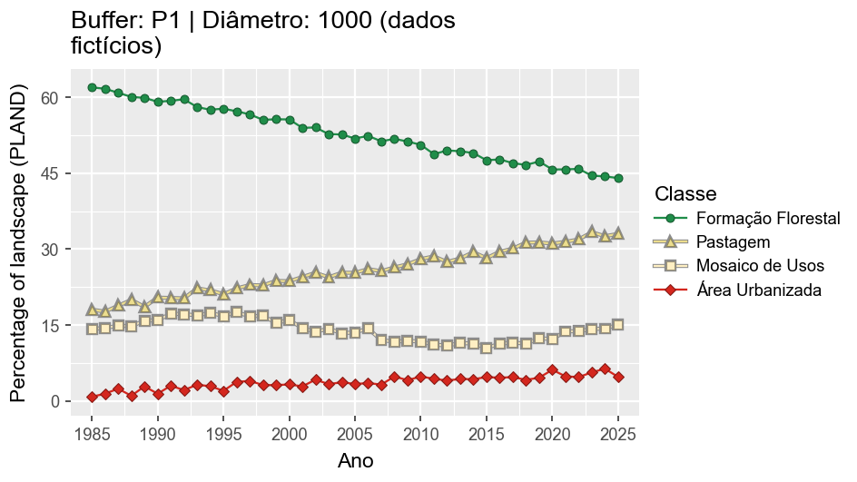

# GeoLand V1

Aplicativo desktop para Windows (interface gráfica em Tkinter) que calcula
**métricas da estrutura da paisagem** em lote, a partir de rasters de uso e
cobertura da terra, com dois motores de cálculo:

- **PyLandStats** (Python)
- **landscapemetrics** (pacote do R, chamado via `rpy2`)

O executável já traz o Python, o R 4.5.2 e os pacotes `landscapemetrics` e
`terra` embutidos: **não é preciso instalar Python nem R** para usar.

## Download e instalação

1. Baixe o executável:
   **[GeoLand_V1_win64.zip](https://github.com/rnvuefsppgm/GeoLand/raw/main/executavel/GeoLand_V1_win64.zip)**
   (311 MB).
2. Extraia o `.zip` em qualquer pasta (ex.: `C:\GeoLand_V1`).
3. Abra a pasta `GeoLand_V1` e dê duplo clique em **`GeoLand_V1.exe`**.

Use o link acima: o botão **Code → Download ZIP** traz só o código-fonte,
porque o zip do executável é armazenado em Git LFS.

Requisitos: Windows 10 ou 11, 64 bits. Mantenha o `.exe` junto da pasta
`_internal` — copiar só o `.exe` não funciona. Na primeira abertura o Windows
SmartScreen pode avisar que o aplicativo não é assinado; escolha
"Mais informações" → "Executar assim mesmo".

Para conferir se os dois motores funcionam na sua máquina, abra um terminal
na pasta do executável e rode:

```bat
GeoLand_V1.exe --teste-motores relatorio.txt
```

O arquivo `relatorio.txt` deve terminar com `RESULTADO: OK`.

Para testar a aba 6 (Métricas) com os seus próprios rasters, sem abrir a
interface — os dois motores, os três níveis e todas as métricas, em paralelo:

```bat
GeoLand_V1.exe --teste-metricas C:\pasta\dos\rasters C:\pasta\de\saida
```

Os CSVs e o arquivo `relatorio_teste_metricas.txt` são gravados na pasta de
saída; o relatório também deve terminar com `RESULTADO: OK`.

Há ainda `GeoLand_V1.exe --teste-gui <pasta_rasters_em_metros> <pasta_saida>`,
que abre a janela e aciona sozinho os botões das abas 4, 6 e 5 (leitura de
subpastas, estrutura replicada, verificação de projeção, reprojeção antes
do cálculo e reclassificação) com uma amostra dos rasters, gravando
`relatorio_teste_gui.txt`. E `GeoLand_V1.exe --teste-graficos <tabela.csv>
<pasta_saida>` faz o mesmo com a aba 10 (leitura da tabela, dicionário de
cores, lote em PNG/PDF/SVG e uma segunda tabela genérica).

## Tutorial de uso

O fluxo completo vai da criação dos pontos amostrais até a tabela final de
métricas. Cada aba é uma etapa; a pasta de saída de uma etapa serve de
entrada para a seguinte. Você pode começar em qualquer aba, desde que já
tenha os arquivos de entrada dela.

Em todas as abas: use os botões **Selecionar** para escolher os arquivos ou
pastas de entrada e a pasta de saída, ajuste as opções e inicie o
processamento. As barras de **Carregamento** e **Processamento** e o
**Log do processamento** mostram o andamento; o botão **Parar** interrompe.

### Dados de entrada

- **Polígonos da área de estudo** em shapefile (`.shp`).
- **Rasters de uso e cobertura** em GeoTIFF (`.tif`), um por ano, com valores
  inteiros representando as classes. Para métricas de área e distância
  corretas, os rasters devem estar em projeção métrica (UTM); a aba 4 faz
  essa reprojeção.

### Aba 1 — Grade de pontos

Gera uma grade regular de pontos dentro dos polígonos. Informe o shapefile
de polígonos, as **distâncias entre pontos** e a **unidade**. A saída é um
shapefile de pontos.

### Aba 2 — Buffers

Cria buffers circulares em torno dos pontos (da aba 1 ou de um ou mais
shapefiles de pontos seus). Informe os **diâmetros dos buffers** e a
**unidade**. Vários diâmetros geram um buffer por ponto para cada tamanho.

### Aba 3 — Recortar rasters

Recorta cada raster por cada feição do shapefile de buffers. Indique o
**Campo ID** e o **Campo diâmetro** do shapefile, a pasta de rasters e a
pasta de saída. Opções: `all_touched` (inclui pixels tocados pela borda) e
**Núcleos paralelos**. Os recortes são gravados em subpastas por ano.

### Aba 4 — Reprojeção de rasters

Reprojeta em lote os rasters de uma pasta. Selecione a **pasta dos rasters
de entrada**: todos os `.tif`/`.tiff` da pasta e das subpastas são
carregados automaticamente, e a pasta de saída recebe a **mesma estrutura
de subpastas**. Informe o **EPSG** de destino (o botão **Sugerir EPSG**
propõe um código), a **Reamostragem** e o número de núcleos. Use antes das
abas 3 e 6 se os rasters estiverem em graus (na aba 6 também é possível
reprojetar automaticamente antes do cálculo).

### Aba 5 — Reclassificar rasters

Reclassifica rasters em lote por regras `Val_Min, Val_Max, Novo_Val` (a aba
"Reclassificar" do GeoRasterTools, equivalente ao `terra::classify`). Serve,
por exemplo, para agrupar classes do MapBiomas antes de calcular as métricas.

1. Selecione a **pasta dos rasters de entrada** (as subpastas são lidas e
   replicadas na saída) e a **pasta de saída**. A lista de arquivos é
   preenchida ao selecionar a pasta; **Escanear arquivos** relê a pasta.
2. Em **Parâmetros de saída**, escolha o tipo de dado, o valor dos pixels
   não mapeados (sem valor ou zero), o lado fechado do intervalo e o
   prefixo do nome de saída (`Reclass_` por padrão).
3. No **Editor de regras**, dê duplo clique em uma célula para editar e use
   **+ Linha** e **- Linha selecionada**. A regra `Padrao` agrupa as classes
   do MapBiomas nos valores 1 (vegetação natural), 14 (agropecuária),
   22 (área não vegetada), 24 (área urbana) e 26 (água).
4. Para usar regras diferentes por arquivo, crie outro conjunto (**Criar**)
   ou carregue um `.txt` (**Carregar .txt**), selecione arquivos na lista e
   clique em **Atribuir regra ativa aos selecionados**. **Salvar .txt**
   grava as regras do editor (o formato é o mesmo do GeoRasterTools).
5. **Executar reclassificação** grava
   `<pasta de saída>\<subpasta>\Reclass_<nome>.tif`.

Com "NA (sem valor)", os pixels sem dado e os não mapeados recebem o valor
de sem-dado do tipo escolhido (255 em 8 bits). A aba 6 continua lendo o
ano do nome do arquivo mesmo com o prefixo `Reclass_`.

### Aba 6 — Métricas

Calcula as métricas para todos os rasters de uma pasta.

1. Selecione a pasta de rasters (marque **Ler todas as subpastas** se os
   recortes estiverem em subpastas por ano) e a pasta de saída.
2. Marque os níveis: **Patch**, **Classe** e/ou **Paisagem**.
3. Escolha a **Vizinhança** (4 ou 8 vizinhos).
4. Em **Motores**, marque **PyLandStats**, **landscapemetrics (R)** ou ambos.
   Para o motor R, confira o **cellsize (R)** (tamanho do pixel, 30 por padrão).
5. Clique em **Verificar projeção (metros)** para conferir o CRS de cada
   raster: o log lista cada arquivo que não está em metros (graus, sem CRS
   ou ilegível) e mostra o total.
6. Se houver rasters fora de metros, marque **Reprojetar para metros (UTM)
   antes do cálculo**: cada um deles é reprojetado (vizinho mais próximo)
   para o SIRGAS 2000 / UTM da sua zona e gravado em
   `<pasta de saída>\rasters_reprojetados_metros`, com o mesmo nome e as
   mesmas subpastas; os originais não são alterados.
7. Nas páginas "Métricas PyLandStats" e "Métricas landscapemetrics (R)",
   escolha as métricas de cada nível (botões **Todas** e **Limpar**).
8. Inicie o cálculo. São gravados um CSV por raster e um CSV geral.
9. Para o **Índice de Estabilidade da Paisagem (IEP)**, marque a caixa
   "Calcular o IEP ao terminar as métricas de todos os anos". O índice
   precisa da série temporal inteira, então sai só no final, em
   `indice_estabilidade_IEP_<motor>_<data>.csv`, com uma linha por buffer,
   classe e raio.

**Como o IEP é calculado** (mesma base do `script_calculo_estabilidade.R`):
para cada buffer × classe × raio, o coeficiente de variação entre os anos de
CA, PLAND, NP, LPI e ENN_MN; cada CV é normalizado entre 0 e 1 em relação a
todas as combinações da tabela; a variabilidade é a média dos CVs
normalizados de composição (CA, PLAND), configuração (NP, LPI) e
conectividade (ENN_MN), com peso 1/3 cada; e `IEP = 1 − variabilidade`.
Quanto mais perto de 1, mais estável a classe no período. A coluna `n_anos`
mostra em quantos anos a classe apareceu: com um único ano o CV é 0 e o IEP
vale 1, o que não indica estabilidade real. Como a normalização depende do
conjunto, o IEP muda se a tabela tiver outros buffers.

### Aba 7 — Fundido (memória)

Faz o recorte (aba 3) e as métricas (aba 6) de uma vez, sem gravar os
recortes em disco — indicado para muitos buffers e muitos anos. Roda em
paralelo e pode **retomar de onde parou**. Pode salvar CSV por feição,
Parquet por ano, Parquet único e shapefile com métricas.

### Aba 8 — Consolidar tabelas

Junta os CSVs (ou Parquets) gerados em uma tabela única. Informe o nome base
do arquivo e os formatos de saída: **CSV único**, **Parquet único** ou
**Parquet por ano**.

### Aba 9 — Buffer + Métricas (SHP)

Junta a tabela de métricas ao shapefile de buffers pelo **Campo ID**,
gerando um shapefile com as métricas como atributos, pronto para o QGIS.

### Aba 10 — Gráficos

Gera gráficos de linhas e pontos no padrão visual do ggplot2, um a um ou em
lote, a partir de qualquer tabela (CSV, TXT ou Parquet). Ao selecionar a
tabela, o aplicativo lê o arquivo e cria os campos da aba sozinho.



**Como a tabela é entendida.** Cada coluna recebe um papel:

| Papel | O que é | Tabela de métricas do GeoLand | Outra tabela (exemplo) |
|---|---|---|---|
| Eixo X | a sequência do gráfico | `year` | `Ano` |
| Linhas | o que separa as linhas | `class_val` (classes) | `Cultura` |
| Um gráfico para cada | o que identifica cada gráfico | `Buffer` + `Raio` | `Municipio` |
| Métricas (eixo Y) | colunas numéricas; um gráfico por métrica | `ca`, `np`, `enn_mn`... | `Produtividade` |
| Filtros | valores de cada coluna de categoria | `level`, `Buffer`, `class_val`... | `Municipio`, `Cultura` |

Nas tabelas do GeoLand, `Buffer` e `Raio` são criados a partir do nome
do raster (`clip_id_<ID>_diam_<DIAM>_<ANO>`). O separador (vírgula, ponto e
vírgula ou tab), a vírgula decimal e a codificação do CSV são detectados.
Os papéis sugeridos podem ser trocados nas caixas de seleção.

1. Selecione a **tabela de dados** e a **pasta de saída**. O log mostra a
   estrutura encontrada e o primeiro gráfico aparece na pré-visualização.
2. Em **Estrutura**, confira o eixo X, as linhas e as colunas de "um gráfico
   para cada combinação de". Desmarcar `Buffer`, por exemplo, gera um
   gráfico por raio com a média de todos os buffers.
3. Em **Métricas**, marque as métricas desejadas; em **Filtros**, escolha a
   coluna e desmarque os valores que não devem entrar (buffers, classes,
   anos...). O rodapé informa quantos gráficos serão gerados.
4. Em **Aparência**, escolha o tema (cinza do ggplot2, branco com grade ou
   clássico), a posição da legenda, os formatos (PNG, PDF, SVG), o tamanho
   em centímetros, a fonte e o DPI. Os textos aceitam `{metrica}`, `{sigla}`
   e `{painel}`: por exemplo, eixo Y `{metrica} (ha)`.
5. **Pré-visualizar** mostra o gráfico escolhido em "Gráfico individual" e
   **Salvar este gráfico** grava só ele.
6. **Gerar TODOS os gráficos selecionados** grava
   `<pasta de saída>\<métrica>\<métrica>__Buffer-<ID>_Raio-<RAIO>.png`.

**Cores e nomes das classes.** Se houver um arquivo `cores.txt` na pasta da
tabela, ele é lido automaticamente; cada linha tem `valor, "#rrggbb", nome`
(por exemplo `3, "#1f8d49", Formação Florestal`). **Escolher cores...** abre
o dicionário de cores: uma linha por classe, com duplo clique para abrir o
seletor de cores, edição do nome da legenda, preenchimento por paleta
(ggplot2, Viridis, Turbo, Espectral...) e os botões **Salvar .txt** e
**Carregar .txt**. Sem dicionário, as cores são as do ggplot2.

**Gráficos do índice.** A caixa "6. Índice de Estabilidade da Paisagem (IEP)"
calcula o índice com a tabela carregada (precisa das colunas de CA, PLAND,
NP, LPI e ENN_MN de classe) e gera os gráficos dele em
`<pasta de saída>\indice_estabilidade`, junto com a tabela
`indice_estabilidade_IEP.csv`. Marque os resultados (IEP, variabilidade
global, composição, configuração, conectividade) e o eixo X: **Raio** (um
gráfico por buffer) ou **Buffer** (um gráfico por raio); as linhas são as
classes. O cálculo usa todos os buffers, classes e raios da tabela; o
filtro de anos define o período, e os filtros de buffer, raio e classe só
escolhem o que é desenhado.

A linha de cada classe é interrompida nos anos em que a classe não tem
valor; marque **Ligar lacunas** para unir os pontos. As siglas do
landscapemetrics aparecem com o nome por extenso no eixo Y, como
`Number of patches (NP)`.

## Estrutura do repositório

```
main.py                                          Ponto de entrada; configura o R embutido
app_grade_buffer_shapefile_v18_pylandstats_R.py  Interface e processamento
geoland_graficos.py                              Aba 10: leitura de tabelas e gráficos
nomes_metricas_lsm.py                            Nomes das métricas do landscapemetrics (gerado)
exemplos/grafico_exemplo.png                     Figura de exemplo (dados fictícios)
GeoLand.spec                                     Especificação do PyInstaller
requirements.txt                                 Dependências Python
montar_R_portatil.ps1                            Monta a pasta R_portable (R + pacotes)
build_windows.bat                                Cria o venv e gera o executável
executavel/GeoLand_V1_win64.zip                  Executável compilado (Git LFS)
```

O zip contém a pasta `GeoLand_V1` com o `GeoLand_V1.exe` e a subpasta
`_internal` (Python, bibliotecas e o R portátil), cerca de 760 MB extraídos.

## Executar pelo código-fonte

Requer Python 3.11 (64 bits). O motor R, nesse modo, usa a pasta
`R_portable` se ela existir; senão, o R instalado no sistema.

```bat
python -m venv venv
venv\Scripts\activate
pip install -r requirements.txt
python main.py
```

## Gerar o executável

Requer Python 3.11 (64 bits), R 4.x (64 bits) instalado e internet.

```bat
build_windows.bat
```

O script cria o venv, monta a pasta `R_portable` (cópia do R instalado, com
`landscapemetrics` e `terra` baixados do CRAN), instala as dependências e
roda o PyInstaller. O resultado fica em `dist\GeoLand_V1\GeoLand_V1.exe`.

## Solução de problemas

| Sintoma | Solução |
|---|---|
| "Failed to load Python DLL" ao abrir | O `.exe` foi separado da pasta `_internal`. Use a pasta `GeoLand_V1` inteira. |
| Antivírus ou SmartScreen bloqueia | O executável não é assinado; libere a execução. |
| Motor R falha | Rode `--teste-motores` e veja o relatório; confirme que `_internal\R` existe. |
| "Can't pickle <function _lsm_r_init>" ou "WinError 6" ao calcular métricas | Erro da primeira compilação da V1, já corrigido: baixe o zip de novo. |
| Áreas ou distâncias estranhas | Rasters em graus: reprojete para UTM na aba 4. |
| Demora para abrir | Normal na primeira execução (o antivírus examina os arquivos). |

## Componentes de terceiros

O pacote distribuído inclui o R, `landscapemetrics`, `terra` e `rpy2`,
licenciados sob a GPL, além de bibliotecas Python de código aberto
(PyLandStats, GeoPandas, Rasterio e outras). Os códigos-fonte desses
componentes estão em https://cran.r-project.org e https://pypi.org.
